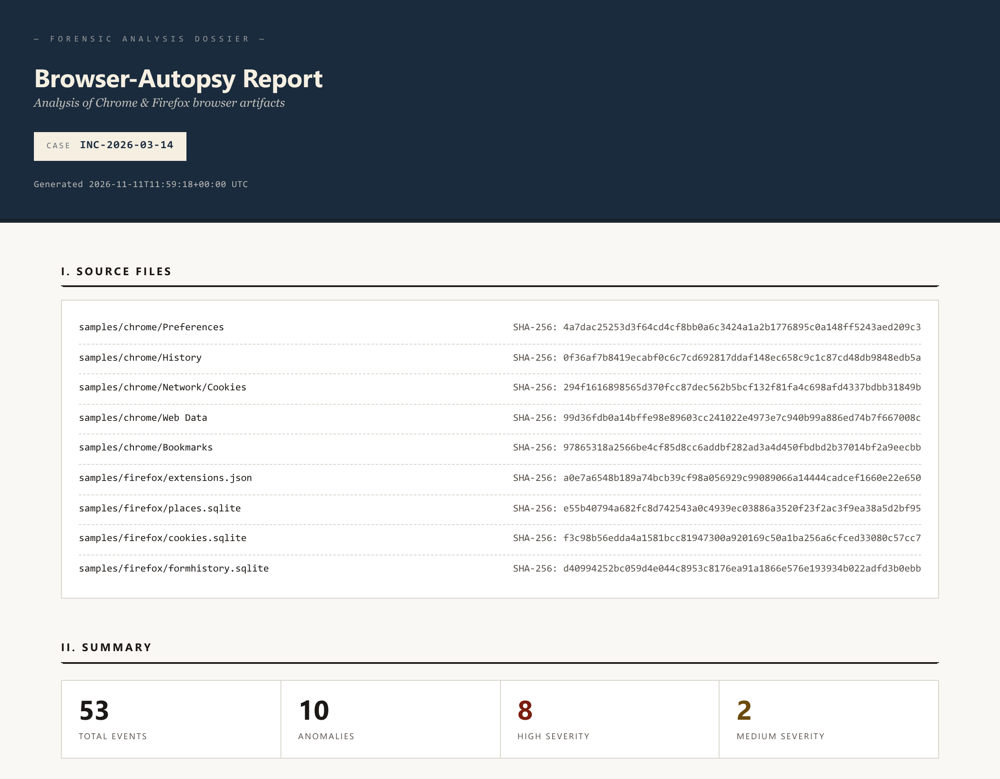
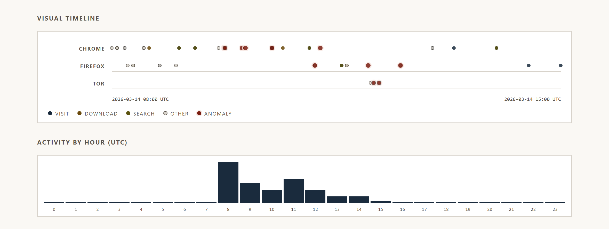
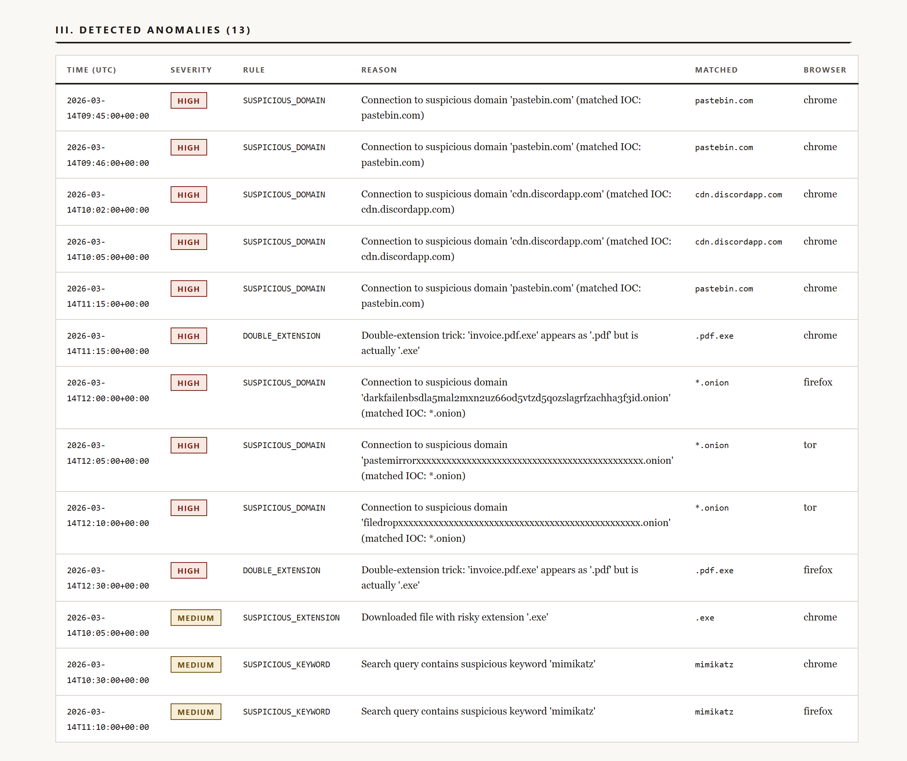
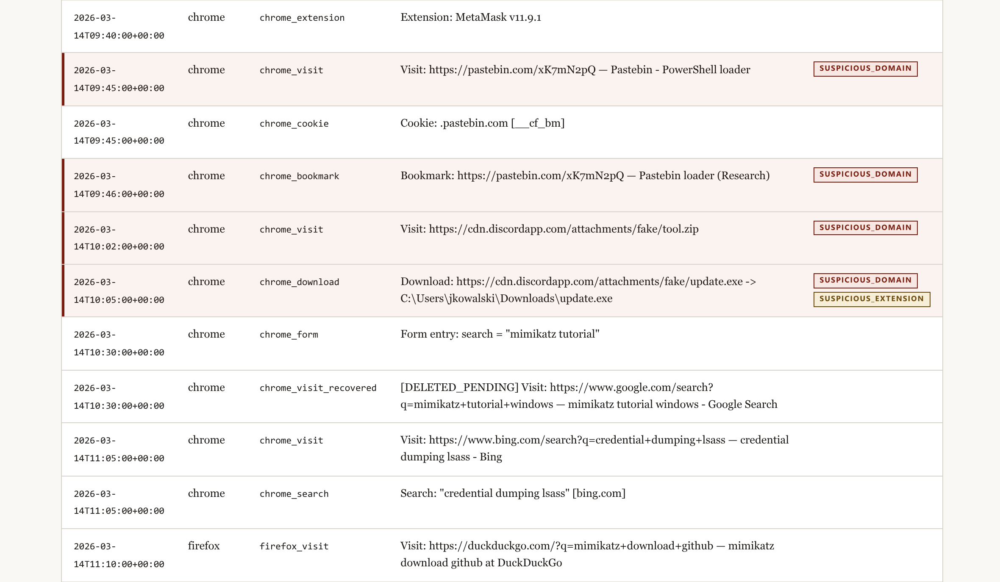

```
██████╗ ██████╗  ██████╗ ██╗    ██╗███████╗███████╗██████╗ 
██╔══██╗██╔══██╗██╔═══██╗██║    ██║██╔════╝██╔════╝██╔══██╗
██████╔╝██████╔╝██║   ██║██║ █╗ ██║███████╗█████╗  ██████╔╝
██╔══██╗██╔══██╗██║   ██║██║███╗██║╚════██║██╔══╝  ██╔══██╗
██████╔╝██║  ██║╚██████╔╝╚███╔███╔╝███████║███████╗██║  ██║
╚═════╝ ╚═╝  ╚═╝ ╚═════╝  ╚══╝╚══╝ ╚══════╝╚══════╝╚═╝  ╚═╝
   █████╗ ██╗   ██╗████████╗ ██████╗ ██████╗ ███████╗██╗   ██╗
  ██╔══██╗██║   ██║╚══██╔══╝██╔═══██╗██╔══██╗██╔════╝╚██╗ ██╔╝
  ███████║██║   ██║   ██║   ██║   ██║██████╔╝███████╗ ╚████╔╝ 
  ██╔══██║██║   ██║   ██║   ██║   ██║██╔═══╝ ╚════██║  ╚██╔╝  
  ██║  ██║╚██████╔╝   ██║   ╚██████╔╝██║     ███████║   ██║   
  ╚═╝  ╚═╝ ╚═════╝    ╚═╝    ╚═════╝ ╚═╝     ╚══════╝   ╚═╝   
```

# Browser-Autopsy

Offline forensic analyzer for Chromium and Gecko browser artifacts, built for
DFIR work. It reads copied browser profiles, builds one timeline, recovers
deleted history from the SQLite WAL, flags suspicious activity against an IOC
list, and writes HTML, CSV and JSON reports.

The tool makes no network calls. It uses no external API and no live capture.



## Contents

1. [What it does](#what-it-does)
2. [The report](#the-report)
3. [Install](#install)
4. [Quick start](#quick-start)
5. [Demo with sample data](#demo-with-sample-data)
6. [Usage](#usage)
7. [IOC configuration](#ioc-configuration)
8. [Deleted history recovery](#deleted-history-recovery)
9. [Forensic soundness](#forensic-soundness)
10. [Limitations](#limitations)
11. [Project structure](#project-structure)
12. [Testing](#testing)

## What it does

The pipeline has five steps:

1. **Extract.** Read seven artifact types from each browser profile.
2. **Unify.** Convert every record to one event format with a UTC timestamp.
3. **Recover.** Compare each history database with its WAL to find deleted visits (optional).
4. **Detect.** Match events against a configurable IOC list.
5. **Report.** Write a self-contained HTML report, two CSV files and one JSON document.

### Supported browsers

| Engine   | Browsers                                               |
|----------|--------------------------------------------------------|
| Chromium | Chrome, Edge, Brave, Opera, Vivaldi, Chromium, Yandex  |
| Gecko    | Firefox, Tor Browser, LibreWolf, Waterfox              |

### Artifacts

| Artifact     | Chromium source                         | Gecko source                      | Event type     |
|--------------|-----------------------------------------|-----------------------------------|----------------|
| History      | `History`                               | `places.sqlite`                   | `*_visit`      |
| Downloads    | `History`                               | `places.sqlite` (annotations)     | `*_download`   |
| Searches     | URLs in `History`                       | URLs in `places.sqlite`           | `*_search`     |
| Cookies      | `Network/Cookies` or `Cookies`          | `cookies.sqlite`                  | `*_cookie`     |
| Bookmarks    | `Bookmarks`                             | `places.sqlite`                   | `*_bookmark`   |
| Autofill     | `Web Data`                              | `formhistory.sqlite`              | `*_form`       |
| Extensions   | `Preferences`, `Secure Preferences`     | `extensions.json`                 | `*_extension`  |

The `*` stands for the browser label, for example `chrome_visit` or `tor_download`.

Notes on the artifacts:

1. History gives one event for each visit, not one for each URL.
2. Downloads show the final URL of the redirect chain and the local target path. The summary marks a download that did not finish, for example `[CANCELLED]`. State, size and end time are in `details_json` and in `report.json`.
3. Search queries come from visited URLs of nine engines: Google, Bing, DuckDuckGo, Yahoo, YouTube, Ecosia, Brave, Startpage and Yandex.
4. Cookies give metadata only. The tool does not read cookie values.
5. Only `History` (Chromium) or `places.sqlite` (Gecko) is mandatory. The tool skips other missing files with a warning.

### Detection rules

| Rule                   | Severity | Trigger                                                          |
|------------------------|----------|------------------------------------------------------------------|
| `SUSPICIOUS_DOMAIN`    | high     | The URL of an event points to a domain on the IOC list           |
| `DOUBLE_EXTENSION`     | high     | A download such as `invoice.pdf.exe` hides a risky extension     |
| `SUSPICIOUS_EXTENSION` | medium   | The extension of a downloaded file is on the IOC list            |
| `SUSPICIOUS_KEYWORD`   | medium   | A search query contains a keyword from the IOC list              |

## The report

The HTML report is one file with inline CSS and no JavaScript. It opens in any
browser and prints to a clean A4 PDF.

The summary section shows a timeline strip for each browser and the activity for
each hour of the day. Red dots mark events with an anomaly.



The anomaly table lists every hit with its rule, reason and the IOC entry that matched.



The full timeline highlights flagged rows. A visit that the user deleted, but
that is still in the main database image, has the tag `DELETED_PENDING`.



The screenshots show the demo case from this repository. The file
`report_demo.html` in the repository root contains the same report.

### Output files

The `--report` flag selects the files that land in `--output-dir`:

| File            | Content                                                                              |
|-----------------|--------------------------------------------------------------------------------------|
| `report.html`   | Source files with SHA-256, summary, charts, anomaly table and full timeline          |
| `timeline.csv`  | One row for each event, with flat `url`, `query` and `filename` columns and a `details_json` column |
| `anomalies.csv` | One row for each anomaly, with the context of its event                              |
| `report.json`   | Case metadata, source files, full timeline and anomalies in one document             |

The CSV files use UTF-8 with BOM. Excel on Windows then reads non-ASCII text correctly.

A cell that starts with `=`, `+`, `-` or `@` gets a leading apostrophe. A spreadsheet
then shows the cell as text and does not run it as a formula.

## Install

The tool needs Python 3.10 or newer. CI runs Python 3.11, 3.12 and 3.13 on
Linux, Windows and macOS.

With [uv](https://github.com/astral-sh/uv):

```bash
uv sync --extra dev
```

With pip:

```bash
pip install -r requirements.txt
```

## Quick start

```bash
python main.py --chrome-profile /path/to/chrome/Default --case-id INC-2024-001
```

The reports land in `./output/`. Open `output/report.html` in a browser.

## Demo with sample data

The repository contains synthetic artifacts for the case `INC-2026-03-14`. An
employee researches offensive tools, visits flagged domains, downloads
suspicious files and then deletes one history entry. That entry is still
recoverable from the WAL.

1. Run the tool on the sample profiles:

   ```bash
   python main.py \
       --chrome-profile  samples/chrome \
       --firefox-profile samples/firefox \
       --wal-recover \
       --case-id         INC-2026-03-14 \
       --report          all \
       --output-dir      output/demo
   ```

2. Open `output/demo/report.html`.

The run gives 54 events and 11 anomalies. To build the sample artifacts again,
run `python samples/generate.py`.

## Usage

### Full example

```bash
python main.py \
    --input           /evidence/seized_laptop \
    --output-dir      /cases/INC-2024-001/reports \
    --case-id         INC-2024-001 \
    --ioc-file        /cases/INC-2024-001/custom_iocs.yaml \
    --wal-recover \
    --start           2024-01-15T22:00:00 \
    --end             2024-01-16T06:00:00 \
    --report          all
```

### Options

| Flag                | Default              | Description                                                                 |
|---------------------|----------------------|-----------------------------------------------------------------------------|
| `--input`           | none                 | Evidence directory. The tool finds every Chromium and Gecko profile below it |
| `--chrome-profile`  | none                 | Path to one Chromium profile directory                                      |
| `--chrome-browser`  | `chrome`             | Label for that profile: `chrome`, `edge`, `brave`, `opera`, `vivaldi`, `chromium`, `yandex` |
| `--firefox-profile` | none                 | Path to one Gecko profile directory                                         |
| `--firefox-browser` | `firefox`            | Label for that profile: `firefox`, `tor`, `librewolf`, `waterfox`           |
| `--wal-recover`     | off                  | Recover deleted history visits from the SQLite WAL                          |
| `--output-dir`      | `./output`           | Directory for the reports                                                   |
| `--report`          | `both`               | `html`, `csv`, `json`, `both` (HTML and CSV) or `all`                       |
| `--case-id`         | `UNSPECIFIED`        | Case identifier in the report header                                        |
| `--ioc-file`        | `config/iocs.yaml`   | Path to the IOC file                                                        |
| `--start`           | none                 | Earliest event to include, in ISO 8601                                      |
| `--end`             | none                 | Latest event to include, in ISO 8601                                        |

At least one of `--input`, `--chrome-profile` and `--firefox-profile` is mandatory.
You can combine them.

Notes on the time filter:

1. The tool reads a value without a time zone as UTC.
2. Both limits are inclusive.
3. The filter removes events that have no timestamp.
4. A value with a date only means 00:00:00 of that day. To include the full last day, write `--end 2024-01-16T23:59:59`.

### Profile discovery

With `--input`, the tool scans the directory at any depth. A directory with a
`History` file is a Chromium profile. A directory with `places.sqlite` is a
Gecko profile.

The tool reads the browser label from the path of the profile. For example,
`Microsoft/Edge/User Data/Default` gives `edge`. A path with no known browser
name gives `chrome` or `firefox`.

The tool skips a profile that it cannot read and prints a warning to stderr.
The analysis of the other profiles continues.

### Where browser profiles live

| OS      | Chrome                                                | Firefox                                                       |
|---------|-------------------------------------------------------|---------------------------------------------------------------|
| Windows | `%LOCALAPPDATA%\Google\Chrome\User Data\Default`      | `%APPDATA%\Mozilla\Firefox\Profiles\<id>.default-release`     |
| macOS   | `~/Library/Application Support/Google/Chrome/Default` | `~/Library/Application Support/Firefox/Profiles/<id>.default` |
| Linux   | `~/.config/google-chrome/Default`                     | `~/.mozilla/firefox/<id>.default-release`                     |

Work on a copy of the profile. On Windows, a browser that is open locks its
databases, so close it before you copy the files.

### Exit codes

| Code | Meaning                                                                                   |
|------|-------------------------------------------------------------------------------------------|
| `0`  | Success. This includes a run that skipped some profiles found by `--input`                |
| `1`  | Runtime failure: unreadable profile given by flag, no readable profile, missing or invalid IOC file |
| `2`  | Argument error: no profile, invalid date, `--start` later than `--end`                    |

## IOC configuration

The default file `config/iocs.yaml` contains starter content: Tor hidden
services, paste sites, anonymous file sharing, risky file extensions and
offensive security keywords. Use `--ioc-file` to give a different file for an
investigation:

```yaml
suspicious_domains:
  - "*.onion"            # wildcard: any domain that ends with .onion
  - pastebin.com         # exact match: sub.pastebin.com does not match
  - cdn.discordapp.com

suspicious_extensions:
  - .exe
  - .ps1
  - .hta

suspicious_keywords:
  - mimikatz
  - "bypass uac"
  - "disable defender"
```

Matching rules:

1. All matching ignores letter case.
2. A domain entry matches the exact domain. An entry that starts with `*.` matches every domain with that suffix.
3. The tool removes a leading `www.` and a trailing dot from the URL and from the IOC entry before it compares domains.
4. The leading dot of an extension is optional: `exe` and `.exe` are equal.
5. A keyword matches when the search query contains it.

## Deleted history recovery

A SQLite database in WAL mode consists of two files. The main file holds the
state at the last checkpoint. The `-wal` file holds later changes that SQLite
has not yet merged.

A copied profile freezes both files. With `--wal-recover`, the tool reads the
history twice, with the WAL and without it, and compares the two results:

| Tag               | Meaning                                                                    |
|-------------------|----------------------------------------------------------------------------|
| `DELETED_PENDING` | The visit is in the main file, but the WAL deletes it. The user deleted it after the last checkpoint |

A visit that is only in the WAL is a normal visit. The timeline lists it once,
as a `*_visit` event.

The tool identifies a visit by its URL and timestamp. A change of the page
title alone gives no result.

A deleted visit to a search URL also gives a `*_search_recovered` event. The
keyword rule checks this event.

This method compares two valid database states. It does not carve pages. It
cannot recover a record after SQLite merges the WAL and reuses the pages.

## Forensic soundness

1. **Read-only access.** The tool copies each database to a temporary directory and opens the copy. It does not open the original for writing.
2. **Chain of custody.** The tool calculates the SHA-256 of each source file before it reads the file. Every event carries the hash of its source. The report also lists the `-wal` file of a database with its own hash.
3. **Offline operation.** The tool makes no network calls.
4. **UTC timestamps.** The tool converts every browser timestamp to UTC.
5. **Escaped output.** The HTML report escapes all text from the artifacts.

## Limitations

1. The tool does not read cookie values. Chromium encrypts them with a key from the operating system.
2. The tool calculates the hash of a `-wal` file when it writes the report, after it reads the database.
3. The WAL recovery finds only records that SQLite has not yet merged into the main file.
4. The browser label from `--input` comes from the directory path. Use `--chrome-browser` or `--firefox-browser` with an explicit profile to set it.
5. A domain entry without a wildcard does not match subdomains.
6. The report does not list the profiles that the tool skipped. Read stderr for that.
7. The report lists a source file only when the file gives at least one event. A time filter does not remove a file from the list.
8. With `--input`, the tool does not follow directory links. It prints a warning for each link.

## Project structure

```
Browser-Autopsy/
├── main.py                  CLI entry point
├── pyproject.toml
├── requirements.txt
├── report_demo.html         rendered report of the demo case
│
├── config/
│   └── iocs.yaml            default IOC file
│
├── extractors/              read raw browser artifacts
│   ├── base.py              shared helpers and dataclasses
│   ├── chrome.py            Chromium parser
│   ├── firefox.py           Gecko parser
│   └── discovery.py         profile discovery for --input
│
├── analyzers/               process the extracted data
│   ├── timeline.py          one chronological timeline
│   ├── anomaly.py           IOC detection
│   └── wal.py               deleted history recovery from the WAL
│
├── reporters/               write the output
│   ├── html.py              HTML report
│   ├── csv.py               CSV export
│   ├── json.py              JSON export
│   └── templates/
│       └── report.html      report template
│
├── samples/                 synthetic artifacts for the demo case
├── docs/img/                screenshots for this README
└── tests/                   pytest suite
```

## Testing

The pytest suite contains more than 500 tests. Most extractor tests build a
real SQLite database with the schema of the browser and read it back.

| Area       | Test modules                                                                 |
|------------|------------------------------------------------------------------------------|
| Extractors | `test_base`, `test_open_db`, `test_chrome_*`, `test_firefox_*`               |
| Discovery  | `test_discovery`                                                             |
| Analyzers  | `test_timeline`, `test_timeline_artifacts`, `test_anomaly`, `test_wal_recovery` |
| Reporters  | `test_html_reporter`, `test_csv_reporter`, `test_json_reporter`              |
| CLI        | `test_main`                                                                  |

```bash
pytest                          # full suite
pytest tests/test_timeline.py   # one module
pytest -v -k chrome             # tests with "chrome" in the name
```

With uv, put `uv run` before each command.
